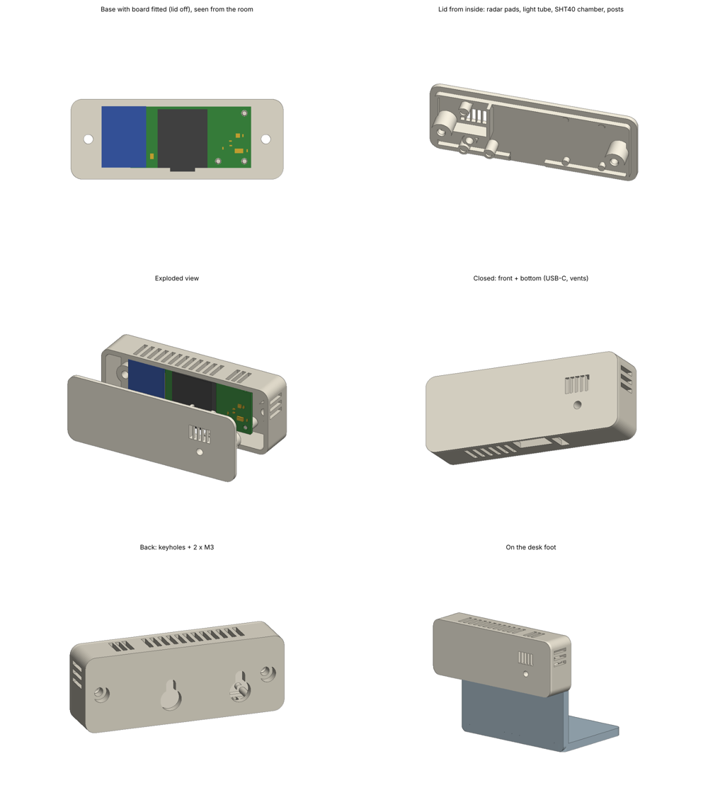

# Room Sensor Lite

A small, low-cost Home Assistant room sensor: **mmWave presence, temperature, humidity and light** on one fully assembled board, in a 3D-printed case that mounts on a wall, a ceiling, a room corner or a desk foot.

Runs [ESPHome](https://esphome.io), plugs in over USB-C, and is designed so the whole board can be assembled by JLCPCB with **Economic PCBA**: no soldering needed, you only screw the case shut.



## Features

| | |
|---|---|
| Presence | Hi-Link **HLK-LD2410C** 24 GHz radar, moving + still targets, ~6 m, ±60° |
| Temperature / humidity | **SHT40**-compatible sensor (Nyfea SHT40-N-NF) in its own vented chamber |
| Window detection | Template sensor in ESPHome: flags a sudden temperature drop |
| Light | **BH1750** behind a light tube and front window |
| MCU | **Seeed XIAO ESP32C6**: Wi-Fi 6, BLE, Thread-capable, onboard antenna + U.FL option |
| Power | 5 V over the XIAO's USB-C |
| Board | 43.3 × 22 mm, 2 layers, single-sided assembly |
| Case | 76 × 29 × 16 mm, resin print, 2 × M3×12 screws, keyholes in the back |

> IKEA MYGGBETT door/window sensors are deliberately **not** used: windows/doors are detected from the temperature drop instead.

## Repository layout

```
hardware/kicad/        KiCad 10 project (schematic + PCB)
hardware/production/   Gerbers, BOM and pick-and-place for JLCPCB
enclosure/             Parametric case (Python + manifold3d) and ready-made STLs
firmware/              ESPHome configuration
docs/                  Images
```

## Bill of materials

All parts are fitted by JLCPCB (Economic PCBA, top side).

| Ref | Part | LCSC | Note |
|---|---|---|---|
| U2 | Seeed XIAO ESP32C6 | C27675191 | castellated, soldered flat |
| SM1 | HLK-LD2410C-P radar | C19723500 | pin header, overhangs the left board edge |
| U1 | Nyfea SHT40-N-NF | C54946589 | I2C 0x44 |
| U4 | ROHM BH1750FVI-TR | C78960 | I2C 0x23, exposed pad not soldered |
| C7 | 10 µF 0805 | C15850 | radar 5 V |
| C9, C11, C12 | 100 nF 0402 | C1525 | C12 = BH1750 DVI power-up reset |
| R8, R9 | 4.7 kΩ 0402 | C25900 | I2C pull-ups |

> The exported `hardware/production/bom.csv` has an empty LCSC field for U2. Enter **C27675191** for it when uploading to JLCPCB (or add the LCSC field to the XIAO symbol before re-exporting).

Per case: 2 × M3×12 socket-head screws (DIN 912, e.g. JLCMC EDLA-J2-M3-L12).

**Approximate cost** (5 units, Oct 2026, incl. shipping, excl. VAT): ≈ $22 per assembled board, plus the case print.

## Pin map (XIAO ESP32C6)

| XIAO | GPIO | Net |
|---|---|---|
| D2 | GPIO2 | RADAR_OUT |
| D3 | GPIO21 | BH1750 DVI |
| D4 | GPIO22 | SDA |
| D5 | GPIO23 | SCL |
| D6 | GPIO16 | ESP TX → radar RX |
| D7 | GPIO17 | ESP RX ← radar TX |
| 5V | VBUS | radar VCC |
| 3V3 | 3.3 V | SHT40, BH1750, pull-ups |

GPIO3 / GPIO14 are used internally by the XIAO's RF switch (set in the ESPHome config).

## Ordering the board (JLCPCB)

1. Upload `hardware/production/gerbers.zip`: 2 layers, 1.6 mm, **LeadFree HASL**.
2. Enable PCB assembly → **Economic**, top side.
3. Upload `bom.csv` and `positions.csv`. Set U2 to C27675191.
4. In the placement preview, check:
   - the XIAO's USB-C points out over the bottom board edge
   - the radar's antenna side (gold patches) faces **up**
   - the pin-1 marks of U1 and U4

## Enclosure

The STLs in `enclosure/` are ready to print. Resin (e.g. JLC3DP 9600) is the default; SLS nylon also works (set `MATERIAL = "nylon"` for a tighter screw pilot hole).

| File | What |
|---|---|
| `lite_base.stl` | wall side: board pins, end bosses, USB-C opening, vents, keyholes |
| `lite_lid.stl` | room side: radar corner pads, light tube, SHT40 chamber + vents, screw posts |
| `lite_foot.stl` | desk stand, hooks into the keyholes |
| `lite_corner_mount.stl` | 45° wedge for a room corner (best radar coverage) |

Assembly: drop the board onto the three pins in the base, put the lid on, and fit the two M3×12 screws from the back.

To change anything, edit the parameters at the top of `room_sensor_case_lite.py` and run:

```bash
pip install manifold3d trimesh numpy
python room_sensor_case_lite.py      # writes the STLs
python render_previews.py            # optional preview images (needs embreex + matplotlib)
```

**Check on your first build:** `RADAR_LIFT` (height of the radar above the board, default 2.5 mm) depends on the radar's pin header.

## Firmware

1. Copy `firmware/secrets.example.yaml` to `secrets.yaml` and fill it in.
2. Flash `firmware/room-sensor-lite.yaml` over USB-C the first time (ESPHome dashboard or web.esphome.io), then OTA.
3. Calibrate the temperature: compare with a reference thermometer for an hour and set `temp_offset`.
4. Tune the radar gates and timeouts in Home Assistant (LD2410 entities).

The config has been validated with ESPHome 2026.10 (`esphome config`).

## Status

Rev "Lite" A: first batch ordered, **not yet tested on real hardware**. Issues and pull requests welcome.

## License

- **Hardware** (`hardware/`, `enclosure/*.stl`): [CERN-OHL-S v2](LICENSE-HARDWARE). You may build, modify and sell it; modified versions you distribute must be released under the same license, with sources.
- **Software** (`firmware/`, `enclosure/*.py`): [MIT](LICENSE-SOFTWARE).

Footprints come from the Seeed Studio OPL KiCad library (XIAO) and EasyEDA / LCSC (other parts), which have their own terms.
